# POSTpractice

Spring Boot로 게시판의 **글·댓글 조회와 삭제** API를 한 단계씩 만들어 보는 실습입니다.

- 참고 강의: [slog 14172](https://www.slog.gg/p/14172/raw) 1부 (1~19강)
- 환경: Spring Boot `4.1.2`, Java `25`, Gradle (Kotlin DSL), H2

## 만들 API

모든 요청은 브라우저 주소창에서 확인할 수 있게 `GET` 방식으로 받습니다. 원래 삭제는 `GET`으로 하면 안 되지만, 실습 편의를 위해 이렇게 합니다.

| 메서드 | URL | 기능 |
|---|---|---|
| GET | `/api/v1/posts` | 글 다건조회 |
| GET | `/api/v1/posts/{id}` | 글 단건조회 |
| GET | `/api/v1/posts/{id}/delete` | 글 삭제 |
| GET | `/api/v1/posts/{postId}/comments` | 댓글 다건조회 |
| GET | `/api/v1/posts/{postId}/comments/{id}` | 댓글 단건조회 |
| GET | `/api/v1/posts/{postId}/comments/{id}/delete` | 댓글 삭제 |

## 범위 밖

- 존재하지 않는 id를 요청했을 때의 예외 처리 (스프링 기본 에러 페이지가 나옵니다)
- 글·댓글 작성, 수정

---

## 1단계: 프로젝트 세팅

### 추가된 것
- IntelliJ의 Spring Boot 마법사로 프로젝트를 생성했습니다.
- 의존성: Spring Web MVC, Lombok, Spring Boot DevTools
- 메인 클래스: `com.back.BackApplication`

### 동작 확인
- 요청: http://localhost:8080/
- 결과: **Whitelabel Error Page (404)**
  - 서버는 떠 있지만 `/` 주소를 처리할 코드가 아직 없어서 404가 나옵니다. 서버가 정상적으로 실행됐다는 뜻입니다.

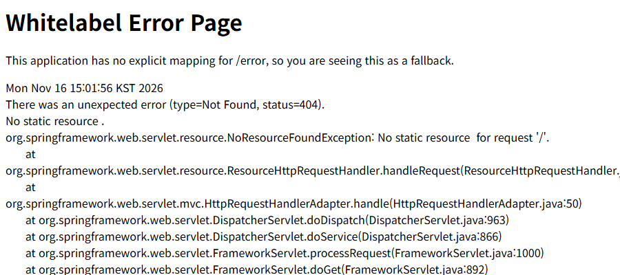

---

## 2단계: JPA·H2 추가, 엔티티, 샘플 데이터 자동 생성

### 추가된 것
- 의존성: Spring Data JPA, H2, H2 Console, Validation
- `application.yaml`: H2 파일 DB(`./db_dev`) 연결, SQL 로그 출력, 테이블 자동 생성(`ddl-auto: update`)
- `BaseEntity`: 모든 엔티티가 공통으로 갖는 `id`, `createDate`, `modifyDate` (`@EnableJpaAuditing`으로 날짜 자동 입력)
- `Post`(글), `PostComment`(댓글) 엔티티: 글 1개 : 댓글 N개 (`@OneToMany` / `@ManyToOne`)
  - 댓글은 `post.addComment()`로만 만들고, 글을 저장하면 댓글도 같이 저장(`cascade PERSIST`)
- `PostRepository`, `PostService`
- `BaseInitData`: 앱 시작 시 데이터가 없으면 글 3개, 댓글 5개를 자동 생성

### 동작 확인
- H2 콘솔: http://localhost:8080/h2-console (JDBC URL `jdbc:h2:./db_dev;MODE=MySQL`, User `sa`, 비밀번호 없음)
- 결과: 글 3개, 댓글 5개가 생성됐고 댓글의 `POST_ID`로 어느 글에 달렸는지 알 수 있습니다. (1번 글에 3개, 2번 글에 2개)

---

## 3단계: 글 다건조회 `GET /api/v1/posts`

### 추가된 것
- `PostService.findAll()`
- `ApiV1PostController`: `@RestController` + `@RequestMapping("/api/v1/posts")`, `@GetMapping`으로 글 목록 반환
- `PostComment.post`에 `@JsonIgnore`

### 3-1. Before: 엔티티를 그대로 반환하면 순환참조
- 요청: http://localhost:8080/api/v1/posts
- 결과: `글 → 댓글 → 글 → 댓글 …`이 끝없이 중첩되다가 Jackson의 중첩 깊이 한도에서 끊깁니다.
  - Jackson은 JSON을 만들 때 모든 getter를 호출합니다. `Post.getComments()` → `PostComment.getPost()` → `Post.getComments()` … 로 무한 반복됩니다.
  - 응답을 이미 보내기 시작한 뒤라 상태코드는 200인데 JSON은 깨져 있습니다.

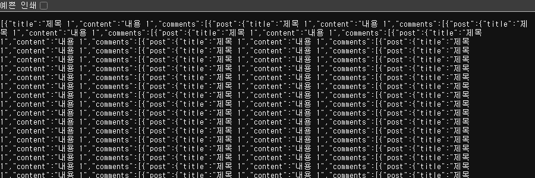

### 3-2. After: `@JsonIgnore`로 `댓글 → 글` 방향을 끊음
- 결과: 글 3개가 정상 JSON으로 나오고, 각 글의 `comments`에는 `post` 없이 댓글 정보만 들어 있습니다.
- 한계: 엔티티를 그대로 내보내면 DB 구조가 API에 노출되고, 엔티티를 고칠 때마다 API 모양도 바뀝니다. → 4단계에서 `PostDto` 도입

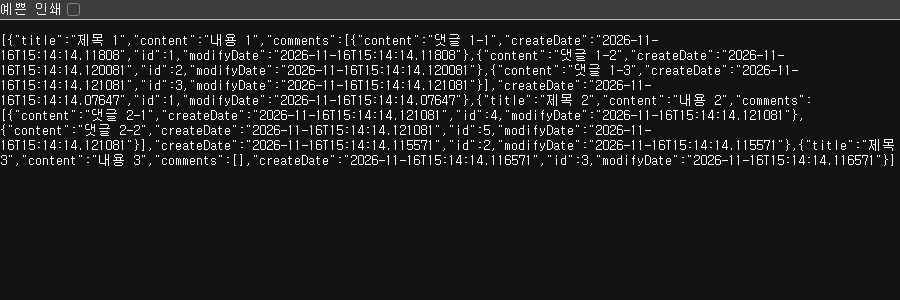

---

## 4단계: `PostDto` 도입과 글 단건조회 `GET /api/v1/posts/{id}`

### 추가된 것
- `PostDto` (record): 엔티티 대신 응답에 쓰는 객체. `id`, `createDate`, `modifyDate`, `title`, `content`만 담고 `comments`는 뺌
- 다건조회 반환 타입을 `List<Post>` → `List<PostDto>`로 변경 (`stream().map(PostDto::new).toList()`)
- `PostService.findById()`, 단건조회 `@GetMapping("/{id}")` + `@PathVariable`

### 동작 확인
- 다건조회: http://localhost:8080/api/v1/posts
  - 3단계와 달리 필드가 record에 선언한 순서(`id`부터)대로 나오고 `comments`가 없습니다.

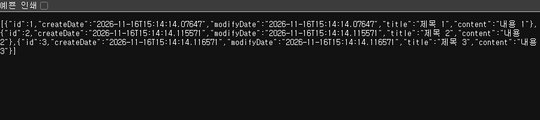

- 단건조회: http://localhost:8080/api/v1/posts/1

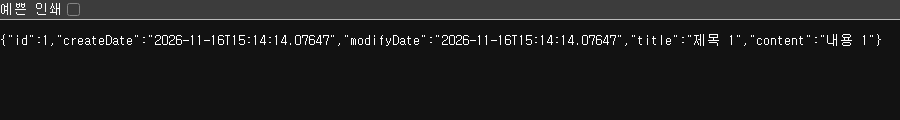

- 없는 글: http://localhost:8080/api/v1/posts/999 → `NoSuchElementException`으로 500 에러 (범위 밖이라 처리하지 않음)

---

## 5단계: 댓글 다건·단건조회와 `PostCommentDto`

### 추가된 것
- `PostCommentDto` (record): `id`, `createDate`, `modifyDate`, `content`
- `Post.findCommentById(id)`: 이 글의 댓글 리스트 안에서만 찾음
- `ApiV1PostCommentController`: `@RequestMapping("/api/v1/posts/{postId}/comments")`
  - 다건조회 `GET /api/v1/posts/{postId}/comments`
  - 단건조회 `GET /api/v1/posts/{postId}/comments/{id}`
  - 항상 **글을 먼저 찾고, 그 글의 댓글 중에서** 찾습니다.

### 동작 확인

| 요청 | 결과 |
|---|---|
| `/api/v1/posts/1/comments` | 200, 댓글 1-1, 1-2, 1-3 |
| `/api/v1/posts/2/comments` | 200, 댓글 2-1, 2-2 |
| `/api/v1/posts/3/comments` | 200, `[]` |
| `/api/v1/posts/1/comments/2` | 200, 댓글 1-2 |
| `/api/v1/posts/2/comments/1` | 500, 1번 댓글은 1번 글 소속이라 2번 글의 댓글 중에는 없음 |

- 1번 글의 댓글 목록

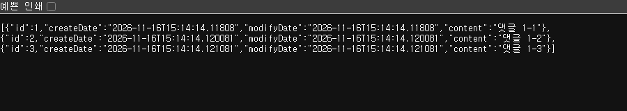

- 1번 글의 2번 댓글

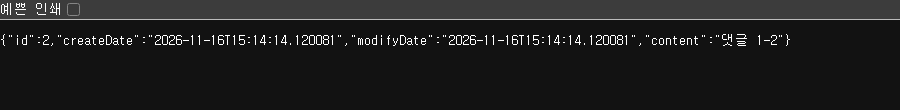

- 2번 글에서 1번 댓글 요청 → 소속이 달라서 찾지 못함

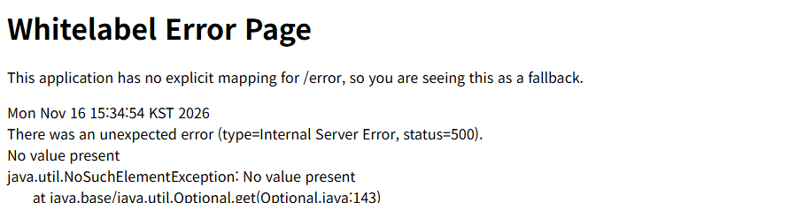

---

## 6단계: 댓글 삭제 `GET /api/v1/posts/{postId}/comments/{id}/delete`

### 추가된 것
- `Post.deleteComment()`: 글의 댓글 리스트에서 댓글을 뺌 (`orphanRemoval = true`라서 리스트에서 빠진 댓글은 DB에서도 삭제 대상)
- `PostService.deleteComment()`
- `ApiV1PostCommentController.delete()`: 글 → 그 글의 댓글 순서로 찾은 뒤 삭제, `"N번 댓글이 삭제되었습니다."` 문자열 응답
- 삭제 메서드에 `@Transactional`

### 6-1. Before: `@Transactional` 없이 삭제
- 요청: `/api/v1/posts/1/comments/3/delete` → "3번 댓글이 삭제되었습니다." 라고 응답

- 그런데 다시 조회하면 댓글 1-3이 그대로 남아 있습니다. 콘솔에도 `delete` SQL이 없습니다.
  - JPA는 변경 내용을 모아 두었다가 **트랜잭션이 커밋될 때** DB에 반영합니다. 트랜잭션이 없으니 자바 메모리의 리스트에서만 빠지고 끝납니다.

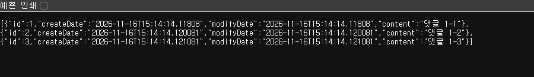

### 6-2. After: `@Transactional` 추가
- 메서드가 끝날 때 커밋되면서 JPA가 리스트에서 빠진 댓글을 감지하고 `delete from post_comment where id=?`를 실행합니다.
- 1번 글 조회: 댓글 1-3이 사라지고 1-1, 1-2만 남음

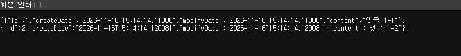

- `/api/v1/posts/2/comments/5/delete` → 삭제 성공, 2번 글에는 댓글 2-1만 남음

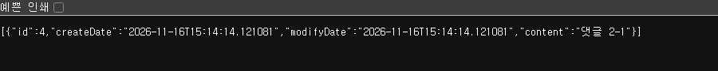

- 이미 지운 3번 댓글을 다시 삭제하면 찾을 수 없어서 500 에러 (범위 밖)

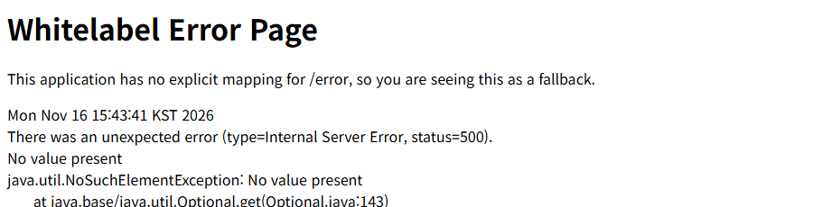

---

## 7단계: 글 삭제 `GET /api/v1/posts/{id}/delete`

### 추가된 것
- `PostService.delete()`: `postRepository.delete(post)`
- `ApiV1PostController.delete()`: `@Transactional`, `"N번 글이 삭제되었습니다."` 문자열 응답
- 글을 지우면 댓글도 함께 지워짐: `Post.comments`의 `cascade = REMOVE` 덕분에 JPA가 댓글을 먼저 `DELETE`하고 그다음 글을 `DELETE`합니다. (댓글의 `post_id` 외래키가 글을 가리키고 있어서 순서가 중요합니다.)

### 동작 확인
- 삭제 전 댓글 테이블: 1번 글에 댓글 1-1, 1-2, 2번 글에 2-1

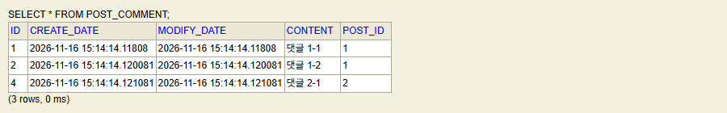

- 요청: `/api/v1/posts/1/delete`

- 글 목록: 2, 3번 글만 남음

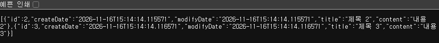

- 댓글 테이블: 1번 글의 댓글 1-1, 1-2도 함께 사라지고 2-1만 남음

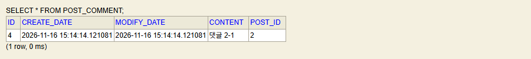

### 진행 중 실수와 교훈
- 글 삭제 메서드를 `ApiV1PostCommentController`의 댓글 삭제 메서드 자리에 덮어써서 `/api/v1/posts/1/delete`가 404가 났습니다. 같은 주소 패턴(`/{id}/delete`)이라도 **어느 컨트롤러에 있느냐**에 따라 `@RequestMapping` 앞부분이 달라져 전혀 다른 URL이 됩니다. 댓글 컨트롤러는 `git restore`로 되돌리고 글 컨트롤러에 다시 넣어 해결했습니다.

---

## 8단계: `RsData<T>` 도입

### 추가된 것
- `RsData<T>` (record): `resultCode`, `msg`, `data` 세 칸으로 응답 모양을 통일
  - `data`의 타입은 제네릭 `T`로 사용하는 쪽에서 정함
  - `RsData(resultCode, msg)` 생성자: `data` 없이 쓸 때 (`null`)
- 댓글 삭제: `String` → `RsData<Void>` (성공 여부와 메시지만)
- 글 삭제: `String` → `RsData<PostDto>` (지워진 글 정보를 `data`에 담음)
- 조회 API는 데이터 자체가 결과이므로 `RsData` 없이 DTO를 그대로 반환합니다.

### 동작 확인
- `/api/v1/posts/2/comments/4/delete` → `RsData<Void>`, `data`는 `null`

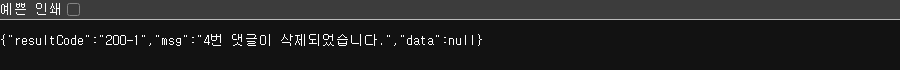

- `/api/v1/posts/3/delete` → `RsData<PostDto>`, `data`에 지워진 3번 글

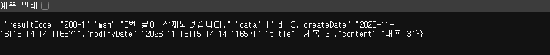

- 남은 글: 2번 글만

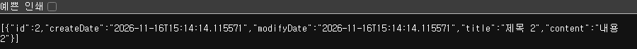

---

## 마무리

6개 API를 모두 구현했습니다. 샘플 데이터를 처음 상태로 되돌리려면 앱을 끄고 `db_dev.mv.db`를 지운 뒤 다시 실행하면 됩니다.

| 단계 | 배운 것 |
|---|---|
| 2 | 엔티티 = 테이블, 연관관계(`@OneToMany`/`@ManyToOne`), `ApplicationRunner`로 샘플 데이터 |
| 3 | 엔티티를 그대로 JSON으로 내보내면 양방향 연관관계에서 순환참조 |
| 4 | DTO(record)로 응답 모양을 직접 정함 |
| 5 | 댓글은 항상 글을 통해서 찾음 |
| 6 | JPA 변경은 트랜잭션 커밋 때 DB에 반영 (`@Transactional`) |
| 7 | `cascade REMOVE`로 글과 댓글을 함께 삭제 |
| 8 | `RsData<T>`로 행위 API의 응답 모양 통일 |
