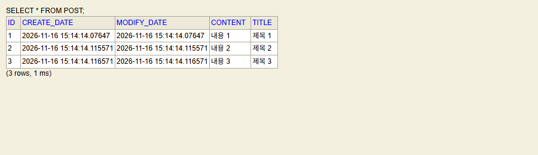
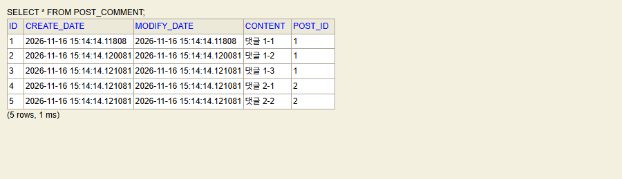

# POSTpractice

Spring Boot로 게시판의 **글·댓글 조회와 삭제** API를 한 단계씩 만들어 보는 실습입니다.

- 참고 강의: [slog 14172](https://www.slog.gg/p/14172/raw) 1부 (1~19강)
- 환경: Spring Boot `4.1.2`, Java `25`, Gradle (Kotlin DSL), H2

## 만들 API

모든 요청은 브라우저 주소창에서 확인할 수 있게 `GET` 방식으로 받습니다. 원래 삭제는 `GET`으로 하면 안 되지만, 실습 편의를 위해 이렇게 합니다.

| 메서드 | URL | 기능 |
|---|---|---|
| GET | `/api/v1/posts` | 글 다건조회 |
| GET | `/api/v1/posts/{id}` | 글 단건조회 |
| GET | `/api/v1/posts/{id}/delete` | 글 삭제 |
| GET | `/api/v1/posts/{postId}/comments` | 댓글 다건조회 |
| GET | `/api/v1/posts/{postId}/comments/{id}` | 댓글 단건조회 |
| GET | `/api/v1/posts/{postId}/comments/{id}/delete` | 댓글 삭제 |

## 범위 밖

- 존재하지 않는 id를 요청했을 때의 예외 처리 (스프링 기본 에러 페이지가 나옵니다)
- 글·댓글 작성, 수정

---

## 1단계: 프로젝트 세팅

### 추가된 것
- IntelliJ의 Spring Boot 마법사로 프로젝트를 생성했습니다.
- 의존성: Spring Web MVC, Lombok, Spring Boot DevTools
- 메인 클래스: `com.back.BackApplication`

### 동작 확인
- 요청: http://localhost:8080/
- 결과: **Whitelabel Error Page (404)**
  - 서버는 떠 있지만 `/` 주소를 처리할 코드가 아직 없어서 404가 나옵니다. 서버가 정상적으로 실행됐다는 뜻입니다.

---

## 2단계: JPA·H2 추가, 엔티티, 샘플 데이터 자동 생성

### 추가된 것
- 의존성: Spring Data JPA, H2, H2 Console, Validation
- `application.yaml`: H2 파일 DB(`./db_dev`) 연결, SQL 로그 출력, 테이블 자동 생성(`ddl-auto: update`)
- `BaseEntity`: 모든 엔티티가 공통으로 갖는 `id`, `createDate`, `modifyDate` (`@EnableJpaAuditing`으로 날짜 자동 입력)
- `Post`(글), `PostComment`(댓글) 엔티티: 글 1개 : 댓글 N개 (`@OneToMany` / `@ManyToOne`)
  - 댓글은 `post.addComment()`로만 만들고, 글을 저장하면 댓글도 같이 저장(`cascade PERSIST`)
- `PostRepository`, `PostService`
- `BaseInitData`: 앱 시작 시 데이터가 없으면 글 3개, 댓글 5개를 자동 생성

### 동작 확인
- H2 콘솔: http://localhost:8080/h2-console (JDBC URL `jdbc:h2:./db_dev;MODE=MySQL`, User `sa`, 비밀번호 없음)
- 결과: 글 3개, 댓글 5개가 생성됐고 댓글의 `POST_ID`로 어느 글에 달렸는지 알 수 있습니다. (1번 글에 3개, 2번 글에 2개)

---

## 3단계: 글 다건조회 `GET /api/v1/posts`

### 추가된 것
- `PostService.findAll()`
- `ApiV1PostController`: `@RestController` + `@RequestMapping("/api/v1/posts")`, `@GetMapping`으로 글 목록 반환
- `PostComment.post`에 `@JsonIgnore`

### 3-1. Before: 엔티티를 그대로 반환하면 순환참조
- 요청: http://localhost:8080/api/v1/posts
- 결과: `글 → 댓글 → 글 → 댓글 …`이 끝없이 중첩되다가 Jackson의 중첩 깊이 한도에서 끊깁니다.
  - Jackson은 JSON을 만들 때 모든 getter를 호출합니다. `Post.getComments()` → `PostComment.getPost()` → `Post.getComments()` … 로 무한 반복됩니다.
  - 응답을 이미 보내기 시작한 뒤라 상태코드는 200인데 JSON은 깨져 있습니다.

### 3-2. After: `@JsonIgnore`로 `댓글 → 글` 방향을 끊음
- 결과: 글 3개가 정상 JSON으로 나오고, 각 글의 `comments`에는 `post` 없이 댓글 정보만 들어 있습니다.
- 한계: 엔티티를 그대로 내보내면 DB 구조가 API에 노출되고, 엔티티를 고칠 때마다 API 모양도 바뀝니다. → 4단계에서 `PostDto` 도입

